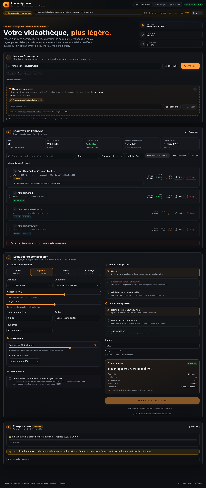
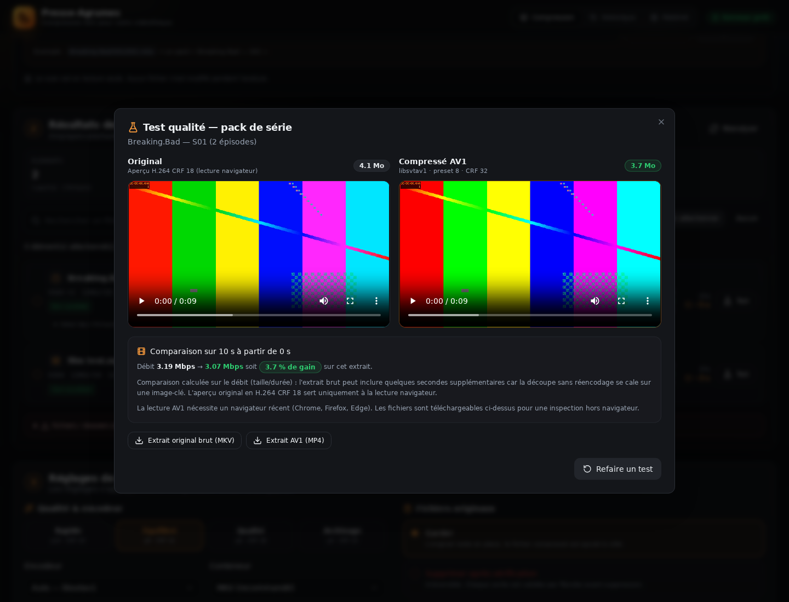
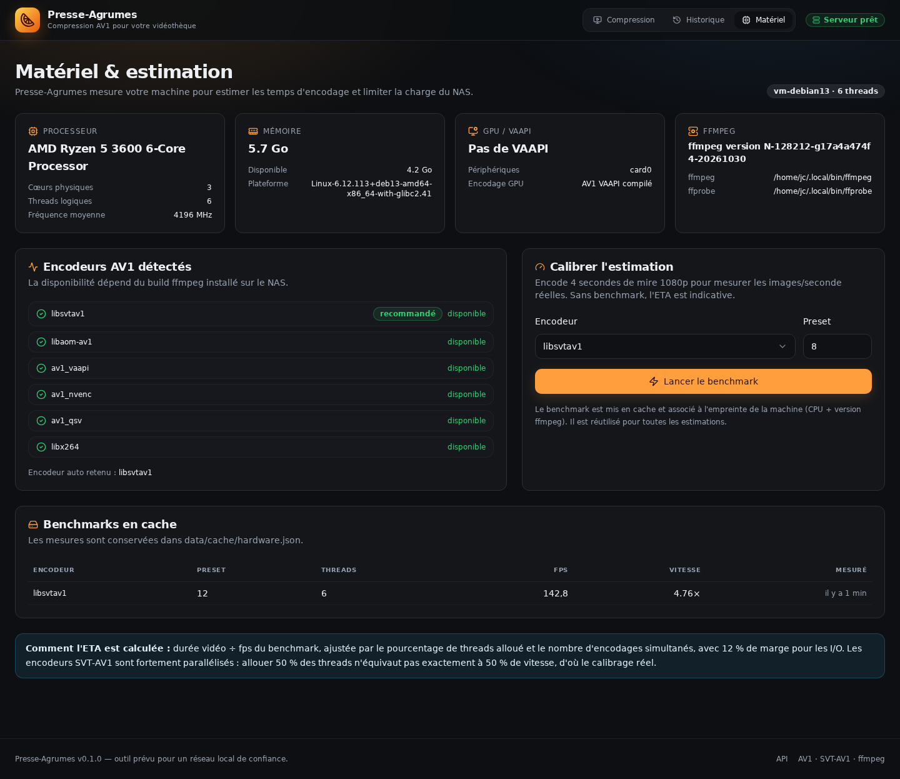
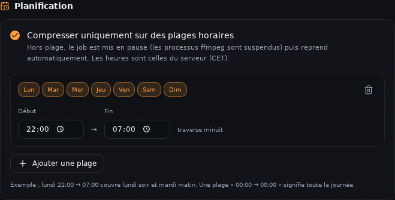
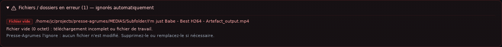
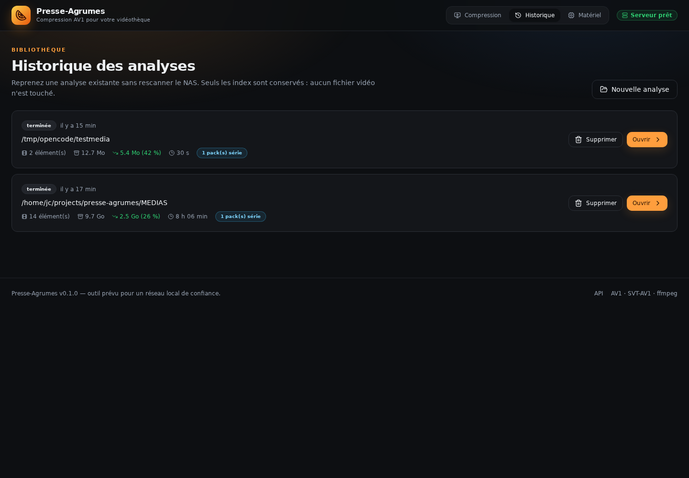

# 🍊 Presse-Agrumes

**Analysez votre bibliothèque vidéo, testez la qualité, puis compressez en AV1 — sans quitter votre navigateur.**

Presse-Agrumes est un outil web auto-hébergé pensé pour les NAS et les serveurs domestiques. Il parcourt un dossier, détecte les vidéos qui valent le coup d'être réencodées en AV1, regroupe les séries par saison, estime le temps sur votre matériel et permet de vérifier le résultat sur un extrait avant de toucher au moindre fichier.

> [!WARNING]
> Cet outil lit, déplace et supprime des fichiers vidéo. Il est conçu pour un **réseau local de confiance**. Ne l'exposez pas directement sur Internet : utilisez un VPN ou, au minimum, l'authentification HTTP Basic intégrée (`config.toml`) derrière un reverse proxy TLS.



## Sommaire

- [Fonctionnalités](#fonctionnalités)
- [Stack technique](#stack-technique)
- [Démarrage rapide](#démarrage-rapide)
- [Installation sur un NAS](#installation-sur-un-nas)
- [Docker (GHCR)](#docker-ghcr)
- [Configuration](#configuration)
- [Guide d'utilisation](#guide-dutilisation)
- [Sécurité et permissions](#sécurité-et-permissions)
- [Structure du dépôt](#structure-du-dépôt)
- [API](#api)
- [Développement et tests](#développement-et-tests)
- [Dépannage](#dépannage)
- [Feuille de route](#feuille-de-route)
- [Licence](#licence)

## Fonctionnalités

- **Analyse récursive** d'un dossier avec progression SSE en temps réel, ETA, annulation et reprise après erreur.
- **Accès protégé au démarrage** : un mot de passe temporaire est généré et affiché dans la console ; HTTP Basic protège toute l'interface.
- **Scan de ports au lancement** : si 8473 est occupé, l'application trouve automatiquement le port libre suivant et affiche l'URL réelle.
- **Détection des bons candidats** : codec, bitrate, résolution, durée, HDR, 10 bits, bits par pixel, gain estimé de façon volontairement pessimiste.
- **Séries regroupées** : un dossier marqué « séries » devient une seule ligne par saison (ou par série), avec le détail des épisodes à la demande. Aucune heuristique imposée : c'est vous qui indiquez les dossiers de séries.
- **Tri, recherche, filtres et sélection** par fichier ou par pack complet — en cliquant sur la ligne entière ou sur la case à cocher.
- **Réglages AV1** : SVT-AV1 / libaom / VAAPI, preset, CRF, 8 ou 10 bits, audio copié ou réencodé, MKV/MP4/WebM, sous-titres.
- **Gestion des originaux** : conserver, supprimer après vérification ffprobe, ou déplacer vers une corbeille en conservant l'arborescence.
- **Destination des fichiers compressés** : même dossier avec suffixe, remplacement sur place, ou dossier personnalisé avec miroir de l'arborescence.
- **Pause / reprise** d'une compression en cours (les processus ffmpeg sont suspendus avec `SIGSTOP`, aucun travail n'est perdu).
- **Planification horaire** : choisissez des plages (jours + heures) ; hors plage, le job se met en pause et reprend automatiquement.
- **Bannière de tâche active** en haut de toutes les pages : progression, ETA, vitesse, pause/reprise et accès au suivi, même après fermeture du navigateur.
- **Estimation matérielle** : détection CPU/RAM/GPU, benchmark ffmpeg réel, ETA selon le pourcentage de ressources alloué et le nombre d'encodages simultanés.
- **Test qualité** : extrait de 20 s (configurable), encodage AV1 et comparaison côte à côte dans le navigateur, avec téléchargement de l'original brut.
- **Gestion des erreurs explicite** : fichier vide, fichier corrompu, permissions, format inconnu et dossiers illisibles sont classés et ignorés sans bloquer le scan.
- **Garde-fous** : jamais de recompression d'un fichier déjà AV1, sortie écrite dans un fichier temporaire puis renommée atomiquement, original supprimé seulement après validation de la sortie.
- **Interface React** responsive, thème sombre, navigation entre compression, historique et matériel.

| Test qualité | Matériel & ETA |
| --- | --- |
|  |  |

| Tâche active, pause et reprise | Planification horaire |
| --- | --- |
|  |  |



| Historique |
| --- |
|  |

## Stack technique

| Couche | Technologie |
| --- | --- |
| Backend | Python 3.10+, FastAPI, Uvicorn |
| Frontend | Vite, React 19, TypeScript |
| UI | Tailwind CSS, composants shadcn/ui (Radix UI), icônes Lucide |
| Routage | React Router |
| Données client | TanStack Query + SSE (progression), repli polling |
| Média | ffmpeg / ffprobe, encodeur SVT-AV1 (recommandé) |
| Persistance | JSON atomique dans `data/` (scans, jobs, tests, benchmark) |

Le backend ne fait confiance à aucun chemin : chaque accès passe par `presse_agrumes/paths.py` et les racines autorisées. Les commandes ffmpeg sont toujours construites sous forme de listes, jamais via un shell.

## Démarrage rapide

### Prérequis

- Linux (Debian/Ubuntu, OMV, Unraid, Synology avec conteneur, etc.) ;
- Python **3.10+** et `python3-venv` ;
- **ffmpeg / ffprobe** avec au moins un encodeur AV1 :
  ```bash
  ffmpeg -hide_banner -encoders | grep -E 'libsvtav1|libaom-av1|av1_vaapi'
  ```
  `libsvtav1` est fortement recommandé (rapide). `libaom-av1` fonctionne mais est beaucoup plus lent.
- Node.js 20+ **uniquement** pour reconstruire l'interface. Le build `frontend/dist` est versionné, donc un NAS sans Node peut lancer l'application telle quelle.

### Installation

```bash
git clone https://github.com/Cafe-Soluble/presse-agrumes.git
cd presse-agrumes
# Éditez config.toml : mot de passe, racines autorisées, port...
chmod 600 config.toml
./run.sh
```

`config.toml` est fourni avec le projet (versionné). **Changez le mot de passe par défaut** avant la première connexion. `run.sh` crée le venv, installe les dépendances, compile le frontend s'il manque, puis démarre le serveur.

Au démarrage, la console affiche :

```text
Port               : 8473  (ou 8474 si 8473 est occupé)
Adresse(s) locale(s) :
  http://192.168.1.50:8473
Authentification   : HTTP Basic
Utilisateur        : agrumes
Mot de passe       : défini dans /opt/presse-agrumes/config.toml
```

Ouvrez l'URL affichée, puis connectez-vous avec les identifiants de `config.toml`. Le navigateur peut demander ces identifiants via sa boîte de dialogue HTTP Basic.

> Le port est scanné automatiquement : si `8473` est déjà utilisé sur le NAS, l'application bascule sur `8474`, `8475`, etc. L'URL exacte est toujours affichée en console.

### Premier usage

1. Connectez-vous avec les identifiants de `config.toml`.
2. Choisissez le dossier à analyser (navigateur de dossiers intégré ou chemin direct).
3. Si le dossier contient des séries, ajoutez-le dans **Dossiers de séries**.
4. Lancez l'analyse, triez par gain potentiel, sélectionnez des fichiers ou des packs (toute la ligne est cliquable).
5. Cliquez sur **Test** pour vérifier la qualité sur un extrait, ou **Suppr.** pour supprimer directement un fichier/pack inutile.
6. Ajustez les réglages, la planification, le devenir des originaux et la destination.
7. Lancez la compression, suivez la progression et le journal. Vous pouvez fermer le navigateur : le travail continue et une bannière reste visible au retour.

## Installation sur un NAS

### Debian / Ubuntu / OMV

```bash
sudo apt update
sudo apt install -y ffmpeg python3-venv git
# Node n'est nécessaire que pour rebuild le frontend :
sudo apt install -y nodejs npm
```

Clonez le dépôt dans `/opt/presse-agrumes`, puis :

```bash
python3 -m venv .venv
.venv/bin/pip install -r requirements.txt
# (facultatif si frontend/dist est présent)
(cd frontend && npm install && npm run build)
```

### Docker (GHCR)

C'est le canal recommandé pour un NAS. L'image est publiée sur
**GitHub Container Registry** (`ghcr.io/cafe-soluble/presse-agrumes`), en
`amd64` et `arm64`. **Pas besoin de git**, et aucun `config.toml` à créer :
la configuration est générée au premier démarrage.

#### Installation recommandée (Docker Compose)

```bash
mkdir -p presse-agrumes/data
cd presse-agrumes

curl -fsSLO https://github.com/Cafe-Soluble/presse-agrumes/releases/latest/download/docker-compose.yml
```

Ouvre `docker-compose.yml` et adapte les **3 valeurs marquées « À ADAPTER »** :

| Ligne | Format | Signification |
| --- | --- | --- |
| `user: "1000:1000"` | `UID:GID` | propriétaire de `./data` et des médias (`id -u`, `id -g`) |
| `- "8473:8473"` | `port navigateur:port interne` | à gauche le port sur le NAS ; à droite 8473, ne pas changer |
| `- /volume1/media:/media` | `hôte:conteneur` | à gauche le dossier média **réel sur le NAS** ; à droite `/media`, ne pas changer |

Puis :

```bash
docker compose up -d
docker compose logs | grep -A6 "première configuration"
```

Le mot de passe généré n'est affiché qu'une fois. Ouvre ensuite
`http://<ip-du-nas>:8473` avec l'utilisateur `agrumes`.

- Configuration : `./data/config.toml` (dans le dossier du projet).
- Au premier lancement, un assistant propose de choisir le dossier média
  (ou « Plus tard »).
- Pour changer le mot de passe ou ajouter des dossiers, édite
  `./data/config.toml` puis `docker compose restart`.
- VAAPI, fuseau horaire et permissions : lignes commentées du Compose et
  [`docs/DOCKER.md`](docs/DOCKER.md).

#### Variante sans Compose (`docker run`)

```bash
docker run -d --name presse-agrumes \
  --restart unless-stopped \
  -p 8473:8473 \
  -v /volume1/media:/media \
  -v presse-agrumes:/data \
  ghcr.io/cafe-soluble/presse-agrumes:0.7.2

docker logs presse-agrumes | grep -A6 "première configuration"
```

Le format des volumes reste `hôte:conteneur` : `/volume1/media` est le dossier
réel sur le NAS, `/media` le chemin vu par l'application. Ici, la configuration
est dans le volume nommé `presse-agrumes` au lieu de `./data`.

> **Nom court (optionnel)** : `docker pull cafesoluble/presse-agrumes` nécessite
> un miroir Docker Hub. Docker Hub n'accepte que lettres minuscules et chiffres
> dans un identifiant, donc `cafe-soluble` n'est pas un namespace valide.
> Le workflow publie le miroir automatiquement si les secrets
> `DOCKERHUB_USERNAME` et `DOCKERHUB_TOKEN` existent. Voir
> [`docs/DOCKER.md`](docs/DOCKER.md#nom-court-via-docker-hub-optionnel).

### Service systemd

Un modèle est fourni dans [`deploy/presse-agrumes.service`](deploy/presse-agrumes.service) :

```bash
sudo cp deploy/presse-agrumes.service /etc/systemd/system/
sudo systemctl daemon-reload
sudo systemctl enable --now presse-agrumes
sudo journalctl -u presse-agrumes -f
```

Adaptez `User`, `Group`, `WorkingDirectory` et le fichier `config.toml` (port, chemins, ffmpeg, mot de passe). L'utilisateur du service doit pouvoir **lire** les médias et **écrire** dans les dossiers de sortie / corbeille.

Éditez `/opt/presse-agrumes/config.toml`, renseignez le mot de passe et faites `chmod 600 config.toml` (utilisateur du service). Le fichier est lu automatiquement depuis le `WorkingDirectory`. Redémarrez après toute modification : `sudo systemctl restart presse-agrumes`.

### Reverse proxy / HTTPS

Placez Nginx, Caddy ou Traefik devant l'application si vous voulez TLS. Exemple Caddy :

```caddyfile
agrumes.mondomaine.local {
  reverse_proxy 127.0.0.1:8473
  basic_auth {
    agrumes $2a$14$...
  }
}
```

Si vous utilisez SSE derrière un proxy, désactivez le buffering pour `/api/jobs/*/events` (`proxy_buffering off;` côté Nginx). L'application envoie déjà `X-Accel-Buffering: no`.

## Configuration

**Toute la configuration est dans `config.toml`, versionné avec le projet. Aucune variable d'environnement n'est utilisée.**

```bash
chmod 600 config.toml
```

Éditez ensuite :

```toml
[server]
host = "0.0.0.0"
port = 8473

[paths]
data_dir = "./data"
allowed_roots = ["/mnt/media", "/srv/media"]

[auth]
user = "agrumes"
password = "votre-mot-de-passe"
disabled = false

[ffmpeg]
# ffmpeg = "/usr/bin/ffmpeg"
# ffprobe = "/usr/bin/ffprobe"
```

| Section | Rôle |
| --- | --- |
| `[server]` | Adresse d'écoute et port préféré. Si le port est occupé, le suivant est choisi automatiquement. |
| `[paths]` | `data_dir` (scans/jobs/benchmarks) et `allowed_roots` (dossiers média autorisés). |
| `[auth]` | Utilisateur et mot de passe HTTP Basic. `disabled = true` uniquement en dev local. |
| `[ffmpeg]` | Chemins absolus facultatifs vers ffmpeg/ffprobe. |

**En production, changez le mot de passe par défaut `changez-moi` et restreignez `allowed_roots`.** Le fichier doit être lisible uniquement par l'utilisateur du service (`chmod 600`, propriétaire adapté).

Pour utiliser un fichier situé ailleurs (Docker, systemd) :

```bash
python -m presse_agrumes --config /config/presse-agrumes.toml
```

Le fichier peut être monté en lecture seule dans un conteneur. Le port, les chemins et le mot de passe sont lus dans ce fichier.

## Guide d'utilisation

### 1. Dossier et séries

- **Dossier à analyser** : racine du scan. Tous les sous-dossiers sont parcourus, sauf `proc`, `sys`, `dev`, `run` et les motifs exclus.
- **Options d'analyse** : taille minimale, threads ffprobe (2 sur disque mécanique, 4–6 sur SSD), motifs d'exclusion (`@eaDir`, `#recycle`, `*.tmp`…), affichage des fichiers déjà AV1.
- **Dossiers de séries** : marquez les dossiers qui *contiennent* des séries. Chaque dossier de saison devient une ligne unique :
  - `Breaking Bad/S01/E01.mkv` → pack « Breaking Bad — S01 » ;
  - `Breaking Bad/E01.mkv` → pack du dossier « Breaking Bad » ;
  - les épisodes ne sont **pas** comparés individuellement dans la liste, mais leur détail est accessible via « Détail des … fichiers ».
- L'analyse est en lecture seule. Le bouton **Annuler** interrompt proprement le scan.

### 2. Résultats et sélection

- Résumé : nombre d'éléments, taille totale, gain potentiel, taille estimée après compression, durée.
- Tri par gain, gain %, taille, durée ou nom ; recherche plein texte ; filtres séries / fichiers / meilleurs gains / déjà AV1.
- **Limite d'affichage** : 10, 20, 30, 50, 100 ou tout. Le bouton **Sélectionner affichés** sélectionne uniquement les N éléments visibles ; **Tout sélectionner** prend tous les éléments filtrés.
- Cochez des fichiers ou des packs entiers. Toute la ligne est cliquable, la case à cocher reste utilisable. Les fichiers déjà AV1 sont désactivés pour la compression.
- **Suppr.** supprime directement un fichier ou un pack (confirmation obligatoire, action irréversible sans corbeille). Pratique pour éliminer les fichiers inutiles avant compression.
- Les erreurs (fichier vide, corrompu, illisible) sont listées à part ; elles peuvent aussi être supprimées directement et ne bloquent pas le scan.

### 3. Réglages AV1

Presets rapides : **Rapide** (preset 10, CRF 34), **Équilibré** (8/32), **Qualité** (6/28), **Archivage** (4/24). Les valeurs restent modifiables.

| Réglage | Valeurs | Conseils |
| --- | --- | --- |
| Encodeur | `auto`, SVT-AV1, libaom, VAAPI | SVT-AV1 pour le CPU ; VAAPI seulement si `/dev/dri/renderD128` est disponible. |
| Preset | 0–13 | Plus bas = meilleure qualité mais plus lent. 8–10 pour un NAS. |
| CRF | 0–63 | Plus bas = meilleure qualité et fichier plus gros. 28–34 en 1080p. |
| Profondeur | 8 ou 10 bits | 10 bits conseillé pour le HDR et les dégradés. |
| Audio | copier / Opus / AAC / supprimer | « Copier » évite toute perte supplémentaire. |
| Conteneur | MKV / MP4 / WebM | MKV recommandé (sous-titres, compatibilité). |
| Sous-titres | copier / ignorer | Copie uniquement vers MKV. |

### 4. Originaux et destination

| Originaux | Comportement |
| --- | --- |
| **Garder** | L'original reste en place, la version AV1 est ajoutée à côté. |
| **Supprimer après vérification** | L'original n'est supprimé qu'après un ffprobe réussi sur la sortie. Action irréversible, confirmation explicite. |
| **Déplacer vers une corbeille** | Déplacement vers un dossier choisi, en conservant l'arborescence relative. |

| Sortie | Comportement |
| --- | --- |
| **Même dossier, nouveau nom** | `film.mp4` → `film.av1.mkv` (suffixe configurable). |
| **Même dossier, même nom** | Remplace le fichier source. Compatible uniquement avec « supprimer » (ou le remplacement assumé). |
| **Autre dossier** | Recrée l'arborescence relative du scan sous le dossier choisi. |

### 5. ETA et ressources

- Le benchmark encode 4 s de mire 1080p avec l'encodeur/preset choisi et mesure les images/seconde réelles.
- L'ETA combine la durée vidéo, le benchmark, le pourcentage de threads alloué, le nombre d'encodages simultanés et une marge de 12 %.
- Sans benchmark pour le preset courant, une table indicative est utilisée : le badge **indicatif** le signale. Le bouton **Calibrer (~5 s)** mesure immédiatement le preset courant.
- **Au lancement d'une compression**, si le preset n'a pas encore de mesure, un benchmark court est exécuté automatiquement avant l'encodage. L'ETA initiale du panneau de suivi est donc basée sur le matériel réel.
- **Pendant la compression**, l'ETA globale est recalculée à partir de la vitesse réelle (`speed` ffmpeg), pas seulement de l'estimation initiale.
- L'ETA affichée dans les résultats avant lancement est une **estimation initiale**, affinée au démarrage. Elle ne peut pas connaître la complexité exacte de chaque vidéo.
- Les processus sont lancés avec `nice 10` pour laisser le NAS réactif. Le pourcentage agit sur le nombre de threads (`lp` pour SVT-AV1), pas sur une isolation stricte du CPU.
- Le benchmark est accessible depuis **Matériel** et mis en cache par machine.

### 6. Test qualité

Depuis une ligne de résultat (fichier ou pack) :

1. Choisissez l'épisode à tester s'il s'agit d'un pack.
2. Réglez la durée (20 s par défaut) et la position (pourcentage ou seconde exacte).
3. Générez : Presse-Agrumes produit un aperçu original H.264 (lecture navigateur), un extrait brut MKV (téléchargement) et un extrait AV1 MP4.
4. Comparez côte à côte, téléchargez, puis ajustez les réglages si nécessaire.

Le gain affiché est calculé sur le **débit** (taille/durée) entre l'extrait brut et l'extrait AV1. La découpe sans réencodage peut inclure quelques secondes supplémentaires (calage sur image-clé) ; le texte de comparaison le précise.

### 7. Compression, pause et reprise

- Le préflight vérifie les chemins, les permissions, les conflits de noms et l'espace disque **avant** de lancer ffmpeg.
- La sortie est écrite dans un fichier temporaire `.pa-tmp-*`, validée par ffprobe, puis renommée atomiquement.
- La progression affiche le fichier courant, le pourcentage, la vitesse, les fps, l'ETA, le journal ffmpeg et le résultat par fichier.
- **Pause** : le bouton met le job en pause et suspend les processus ffmpeg (`SIGSTOP`). Aucun fichier temporaire n'est perdu. **Reprendre** continue exactement au même point.
- Fermer le navigateur n'arrête pas le job. Au retour, une **bannière en haut de page** réaffiche la tâche active, sa progression, son ETA, sa vitesse et les boutons pause/reprise. Le bouton **Suivi** de cette bannière ouvre le panneau détaillé (progression, ETA, pause, journal) et scrolle jusqu'à lui.
- L'historique des analyses permet de reprendre un scan sans rescanner le NAS.

### 8. Planification horaire

Dans **Réglages de compression → Planification** :

- activez « Compresser uniquement sur des plages horaires » ;
- ajoutez une ou plusieurs plages avec les jours, l'heure de début et l'heure de fin ;
- une plage `22:00 → 07:00` traverse minuit ;
- `00:00 → 00:00` signifie toute la journée ;
- hors plage, le job se met en pause automatiquement et reprend au début de la plage suivante.

Les heures sont celles du serveur (le fuseau est affiché dans l'interface). La planification est évaluée toutes les 15 secondes.

### 9. Fichiers en erreur

Les fichiers vides, corrompus, illisibles ou sans flux vidéo sont classés et affichés dans **Fichiers / dossiers en erreur** avec un libellé clair (ex. « Fichier vide », « Format illisible », « Permission refusée ») et un conseil. Ils sont **ignorés automatiquement** par l'analyse et la compression ; le reste du scan continue.

## Comment fonctionne l'estimation du gain

Le facteur de gain dépend du codec source (H.264, HEVC, MPEG-2, etc.), du bits par pixel (bitrate / (largeur × hauteur × fps)) et d'un plafond de 90 %. Les fichiers déjà AV1 ont un gain nul. L'estimation est **pessimiste** : elle sert à trier les candidats, pas à garantir un résultat. Le test qualité reste la référence.

## Sécurité et permissions

- **Réseau local uniquement** : l'application peut lire, déplacer et supprimer des fichiers. N'exposez jamais le port directement sur Internet.
- **Mot de passe** : défini dans `config.toml` (`[auth] password`), avec `chmod 600`. En production, remplacez le `changez-moi` fourni. Aucune variable d'environnement n'est utilisée.
- `allowed_roots` (dans `config.toml`) limite les chemins accessibles. Le navigateur de dossiers ne peut pas sortir de ces racines.
- Pour du TLS, utilisez un reverse proxy devant l'application.
- `[auth] disabled = true` ne doit servir qu'au développement local : l'interface est alors accessible sans mot de passe.
- **Suppression directe** : le bouton **Suppr.** supprime définitivement le fichier/pack avec confirmation. Aucune corbeille n'est utilisée pour cette action.
- Les commandes ffmpeg sont construites sans shell, avec des listes d'arguments. Aucun nom de fichier n'est interprété par un shell.
- Les liens symboliques ne sont pas suivis pendant le scan (évite les boucles et les sorties de racine).
- L'original n'est jamais supprimé avant la validation ffprobe de la sortie.
- Si un fichier/dossier est illisible, il est signalé sans interrompre le scan. Si un dossier de sortie n'est pas inscriptible, le préflight renvoie une erreur explicite.
- L'application ne tourne pas en root : utilisez un utilisateur dédié avec les droits sur les médias.

## Structure du dépôt

```text
presse-agrumes/
├── presse_agrumes/          # backend FastAPI
│   ├── app.py               # routes HTTP, auth, SSE, SPA fallback
│   ├── jobs.py              # scan / compression / test, progression, annulation
│   ├── media.py             # ffprobe, estimation, commandes ffmpeg
│   ├── series.py            # regroupement des saisons/séries
│   ├── schedule.py          # plages horaires, calcul de la prochaine reprise
│   ├── network.py           # scan de ports, adresses IP locales
│   ├── hardware.py          # détection matériel + benchmark + ETA
│   ├── paths.py             # garde-fous chemins, navigation, permissions
│   ├── models.py            # schémas Pydantic
│   ├── storage.py           # JSON atomique
│   └── config.py            # chargement de config.toml, auth, binaires
├── frontend/                # SPA React + TypeScript
│   ├── src/components/ui/   # composants shadcn/ui
│   ├── src/pages/           # workspace, historique, matériel
│   ├── src/lib/             # API typée, formats, estimation
│   ├── e2e/                 # test de fumée Playwright
│   └── dist/                # build versionné (démarrage sans Node)
├── tests/                   # pytest (unitaires + API + encodages réels)
├── docs/                    # architecture, API, développement, releases, journal
├── deploy/                  # unité systemd + exemple d'environnement
├── scripts/dev.sh           # backend reload + Vite
├── scripts/release.sh       # vérifications + tag git de release
├── config.toml              # configuration unique (versionnée, mot de passe à changer)
├── analyze_videos.py        # script CLI historique (référence)
├── run.sh                   # démarrage clé en main
└── data/                    # généré, ignoré par git
```

## API

L'API REST est documentée automatiquement sur [`/docs`](http://localhost:8473/docs) (Swagger UI) et dans [`docs/API.md`](docs/API.md). Les routes principales :

- `POST /api/scans` puis `GET /api/jobs/{id}/events` (SSE) ;
- `GET /api/scans/{id}` ;
- `POST /api/preflight` ;
- `POST /api/compressions` (avec `schedule` optionnel) ;
- `GET /api/jobs/active`, `POST /api/jobs/{id}/pause`, `POST /api/jobs/{id}/resume` ;
- `POST /api/tests` puis `GET /api/tests/{id}/meta` ;
- `GET /api/hardware`, `POST /api/hardware/benchmark` ;
- `GET /api/browse?path=…`.

Exemple de scan :

```bash
curl -X POST http://127.0.0.1:8473/api/scans \
  -H 'Content-Type: application/json' \
  -d '{"root":"/mnt/media","options":{"series_roots":["/mnt/media/Series"]}}'
```

## Développement et tests

Voir [`docs/DEVELOPMENT.md`](docs/DEVELOPMENT.md) et [`AGENTS.md`](AGENTS.md).

```bash
# Backend
.venv/bin/python -m pytest

# Frontend
cd frontend
npm run typecheck
npm run build
npm run test:e2e   # démarre automatiquement un backend de test sur 8099
```

Le test de fumée Playwright vérifie le chargement de la SPA, la navigation et l'absence d'erreurs console. Il utilise `tests/playwright.config.toml` (auth désactivée) et n'a besoin d'aucune variable d'environnement. Sur une VM Debian sans interface graphique, il faut installer Chromium et ses bibliothèques système ; c'est possible en headless (voir `docs/DEVELOPMENT.md`).

## Versionning et releases

Le versionning suit **SemVer** (`MAJOR.MINOR.PATCH`) et chaque release est taguée
dans git :

```bash
git tag -a v0.4.0 -m "Presse-Agrumes v0.4.0"
git push origin v0.4.0
```

Les versions sont synchronisées entre :

- `presse_agrumes/__init__.py` (`__version__`) ;
- `presse_agrumes/config.py` (`VERSION`) ;
- `pyproject.toml` ;
- `frontend/package.json` (+ lock) ;
- `Dockerfile` (`ARG APP_VERSION`) ;
- `CHANGELOG.md` ;
- le tag git `vX.Y.Z`.

Le script `scripts/release.sh X.Y.Z` vérifie la cohérence, lance les tests et le
build, puis crée le tag annoté. Voir [`docs/RELEASES.md`](docs/RELEASES.md).

Tags existants : `v0.1.0` (première version), `v0.2.0` (auth, ports, pause,
planification, bannière active, erreurs enrichies), `v0.3.0` (config.toml,
suppression directe, limites, ETA), `v0.4.0` (configuration uniquement par
fichier, suppression des variables d'environnement), `v0.4.1` (nettoyage du
lancement), `v0.5.0` (Docker multi-arch GHCR), `v0.6.0` (installation Docker en une
commande, configuration auto-générée), `v0.7.0` (assistant de premier
démarrage, racines Docker élargies), `v0.7.1` (port par défaut 8473),
`v0.7.2` (installation Compose en 3 valeurs, Compose publié avec la release).

## Dépannage

### « Où est le mot de passe ? »

Il est dans `config.toml` :

```bash
grep -A3 '^\[auth\]' config.toml
```

Le mot de passe par défaut du dépôt est `changez-moi` : **changez-le** avant
d'exposer l'interface sur le réseau. Après modification, redémarrez le service.

Sous systemd, le fichier doit appartenir à l'utilisateur du service :

```bash
sudo chown media:media /opt/presse-agrumes/config.toml
sudo chmod 600 /opt/presse-agrumes/config.toml
sudo systemctl restart presse-agrumes
```

### Le port 8473 est déjà utilisé

C'est prévu : l'application scanne les ports suivants et affiche celui qu'elle a
choisi (`8474`, `8475`, …). Pour imposer un port, modifiez `port` dans `config.toml` puis utilisez
`--strict-port` pour échouer en cas de conflit :

```toml
[server]
port = 9000
```

```bash
./run.sh --strict-port
```

### « ffmpeg est introuvable » / « Aucun encodeur AV1 »

```bash
which ffmpeg ffprobe
ffmpeg -hide_banner -encoders | grep -E 'libsvtav1|libaom-av1'
```

Sous systemd, le `PATH` est minimal : renseignez `[ffmpeg] ffmpeg` et `ffprobe` dans `config.toml` avec des chemins absolus.

### Le service ne voit pas les fichiers

Vérifiez que l'utilisateur du service a les droits :

```bash
sudo -u media test -r /mnt/media/film.mkv && echo lisible
sudo -u media test -w /mnt/media && echo inscriptible
```

Puis adaptez `User`, `Group`, les ACL ou `[paths] allowed_roots` dans `config.toml`.

### Le frontend affiche « interface non compilée »

`frontend/dist/index.html` est absent. Lancez :

```bash
cd frontend && npm install && npm run build
```

ou copiez `frontend/dist` depuis une machine où il a été compilé.

### L'ETA est très approximative

Lancez un benchmark depuis la page **Matériel**. Sans benchmark, la table est générique et ne tient pas compte de la charge réelle du NAS.

### La vidéo compressée ne se lit pas dans le navigateur

Le test qualité produit un MP4/AAC exprès pour le navigateur. Le fichier final peut être en MKV/WebM/AV1 ; utilisez VLC, mpv ou un navigateur récent (Chrome/Firefox/Edge). Safari peut nécessiter des réglages supplémentaires.

### Un fichier est marqué « déjà AV1 » alors qu'il ne devrait pas

Vérifiez le codec avec :

```bash
ffprobe -v error -select_streams v:0 -show_entries stream=codec_name -of default=nw=1 fichier
```

## Feuille de route

- Paquet `.deb` Debian/Ubuntu et dépôt APT signé.
- Publication automatique des assets de release (`.deb`, checksums).
- Notifications (webhook, Apprise, e-mail) en fin de job.
- Profils de compression par bibliothèque.
- Support des encodeurs matériels NVENC/QSV/AMF selon les builds ffmpeg.
- Comparateur de captures avant/après avec slider.
- Import de listes de lecture, détection de doublons.

## Licence

MIT — voir [`LICENSE`](LICENSE).

Le script historique [`analyze_videos.py`](analyze_videos.py) est conservé comme référence de la première version CLI ; l'application utilise désormais le moteur `presse_agrumes/media.py`.
